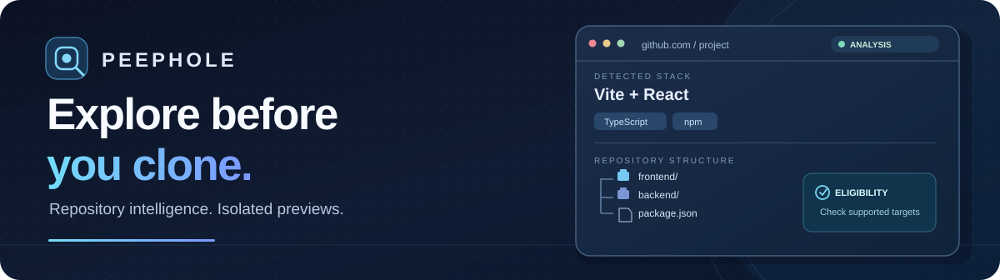

  

  

  <strong>클론하기 전에 GitHub 공개 저장소를 이해하세요.</strong> 
  GitHub 안에서 기술 스택, 프로젝트 구조, 실행 요구사항, 미리보기 지원 여부를 확인할 수 있습니다.

  <a href="https://chromewebstore.google.com/detail/peephole/fieofkhijgngfoflgpkbghbkaidhdgel"><strong>Chrome에 설치</strong></a>
  &nbsp; · &nbsp;
  <a href="https://github.com/The-peephole/peephole"><strong>소스코드</strong></a>
  &nbsp; · &nbsp;
  <a href="https://github.com/The-peephole/peephole/releases/latest"><strong>릴리스</strong></a>

<a href="./README.md">English</a>

---

### 저장소 탐색부터 미리보기까지

| 분석 | 대상 선택 | 격리된 미리보기 |
| :--- | :--- | :--- |
| 프레임워크, 패키지 관리자, 디렉터리 구조, 백엔드 의존성 및 차단 요인을 분석합니다. | 브랜치와 프론트엔드/백엔드 후보를 탐색하며, 분석 대상을 정확한 커밋으로 고정합니다. | 지원되는 프론트엔드를 gVisor 샌드박스에서 빌드하고 Chrome Side Panel에서 확인합니다. |

  

정적 프론트엔드 미리보기 시연이며, 풀스택 미리보기 장면은 포함하지 않습니다.

### 주요 기능

- **저장소 분석:** 클론 전에 기술 스택, 빌드 방식, 환경 요구사항, 호환성 및 제한 사항을 확인합니다.
- **선별적 실행:** 정적 프론트엔드 미리보기를 지원하며, 정해진 Vite + React 및 Express 구성에서는 풀스택 미리보기도 지원합니다.
- **임시 리소스:** 지원되는 풀스택 구성은 조건에 따라 임시 PostgreSQL 데이터베이스와 비민감 환경 설정을 사용할 수 있습니다.
- **명시적 지원 범위:** 지원되지 않는 프레임워크·백엔드 조합은 임의 실행하지 않고 분석 결과와 제한 이유만 제공합니다.

**분석 가능 범위와 실제 실행 가능 범위는 다릅니다.** 자세한 조건은 [지원 프로젝트 목록](https://github.com/The-peephole/peephole#supported-projects)을 확인해 주세요.

### 신뢰할 수 없는 코드를 전제로 한 설계

Peephole은 공개 저장소의 코드와 의존성 설치 스크립트를 신뢰하지 않습니다. 정확한 커밋을 대상으로 작업하고, 리소스를 제한한 **gVisor 샌드박스**에서 빌드·실행하며, 미리보기는 격리된 HTTPS 출처에서 제공합니다.

위 기능이 모든 임의 코드의 안전을 보증하는 것은 아닙니다. 실제 검증 근거와 남은 제한 사항은 [보안 모델](https://github.com/The-peephole/peephole#security-model), [검증 현황](https://github.com/The-peephole/peephole#current-verification)에 기록되어 있습니다.

### 시작하기

1. [Chrome Web Store에서 Peephole을 설치](https://chromewebstore.google.com/detail/peephole/fieofkhijgngfoflgpkbghbkaidhdgel)합니다.
2. GitHub의 **공개 저장소**로 이동해 Peephole을 열고 Side Panel에서 분석 결과를 확인합니다.
3. 지원되는 프로젝트는 안내에 따라 GitHub를 연결하고 미리보기를 실행합니다.

  <a href="https://github.com/The-peephole/peephole/blob/main/README.ko.md">한국어 문서</a>
  &nbsp; · &nbsp;
  <a href="https://github.com/The-peephole/peephole/issues">문의 및 피드백</a>
  &nbsp; · &nbsp;
  <a href="https://github.com/The-peephole/peephole/releases/latest">최신 릴리스</a>

